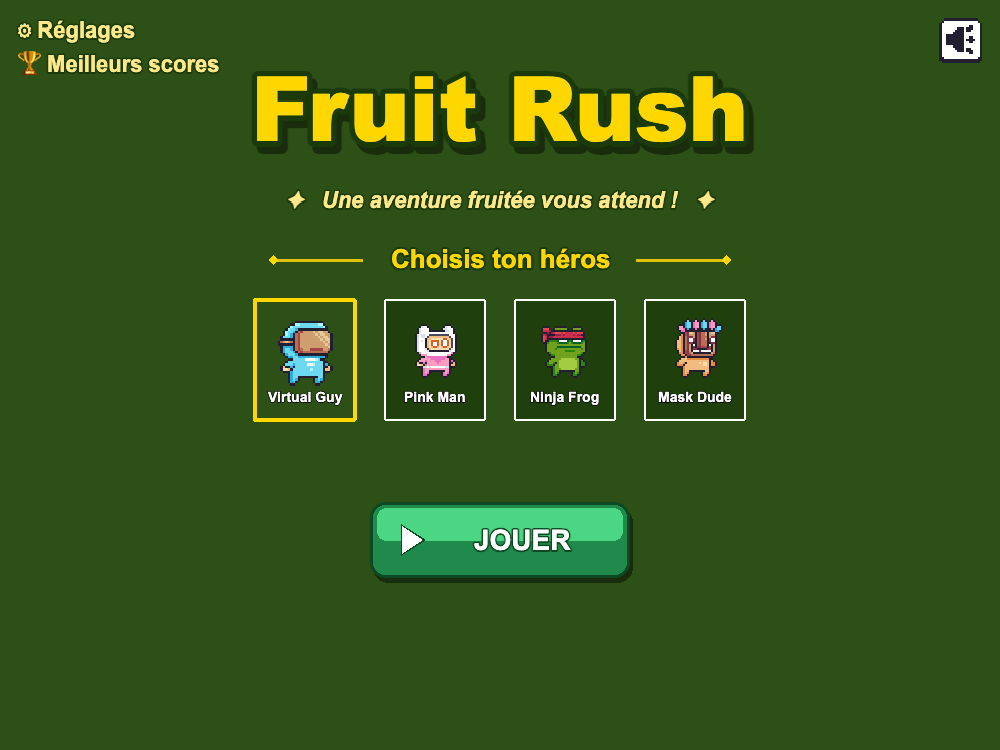
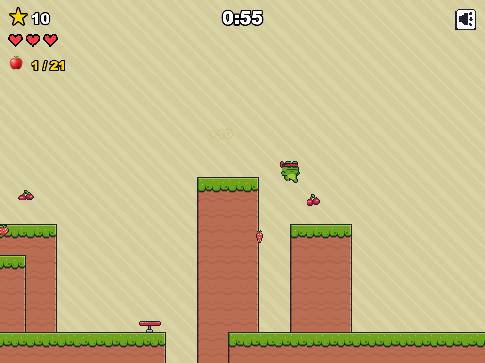
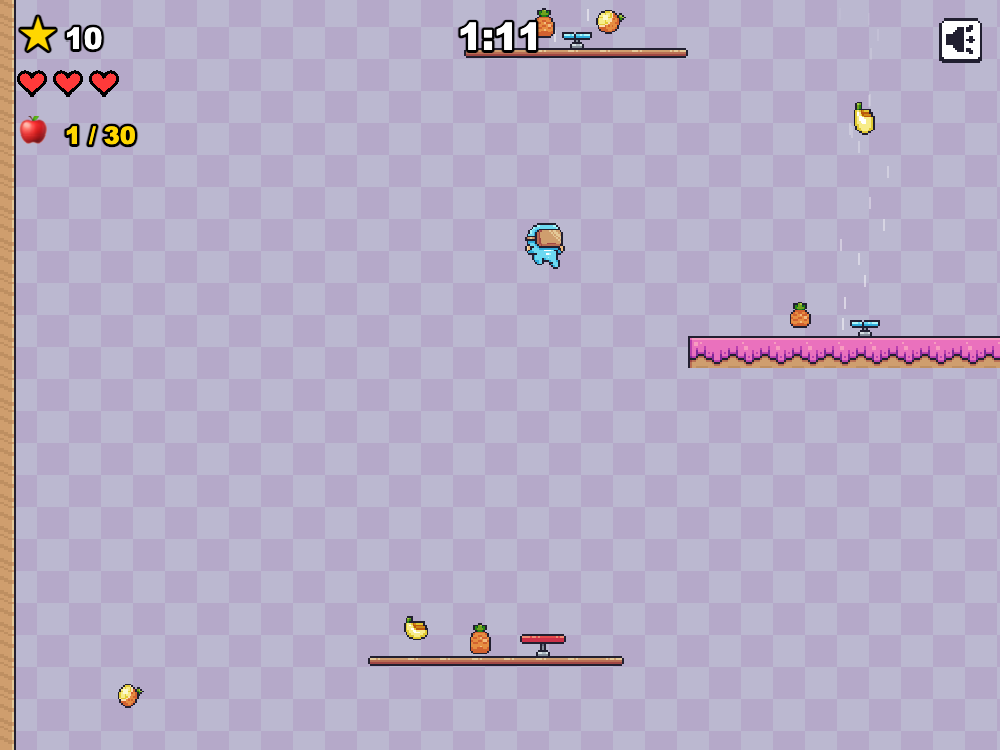
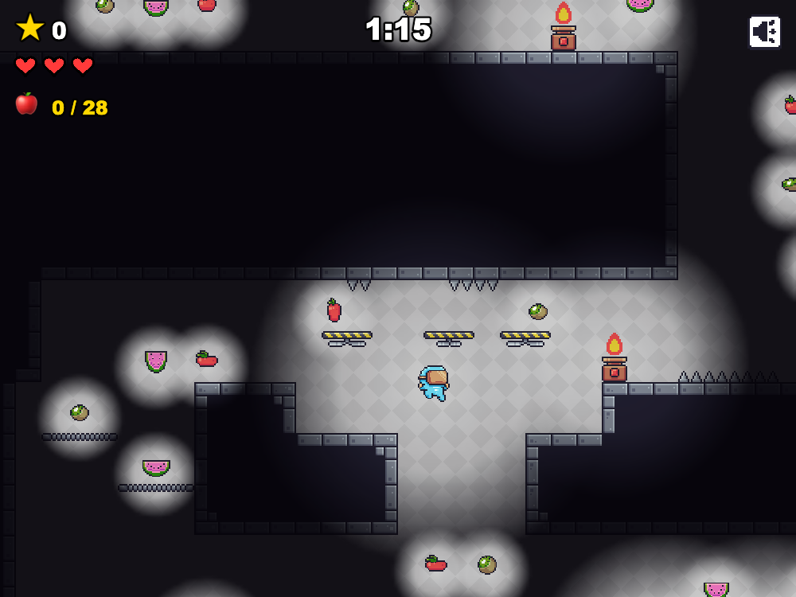
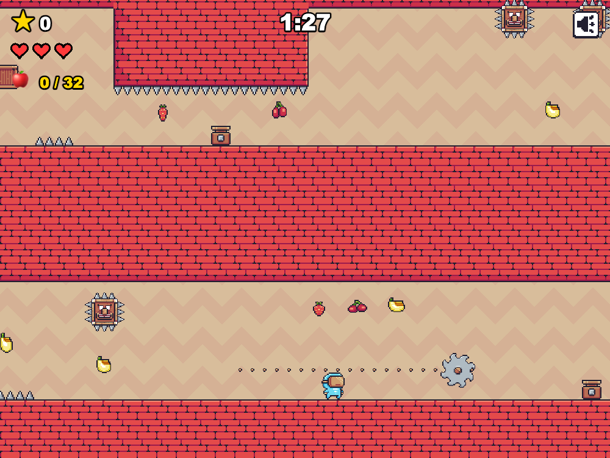
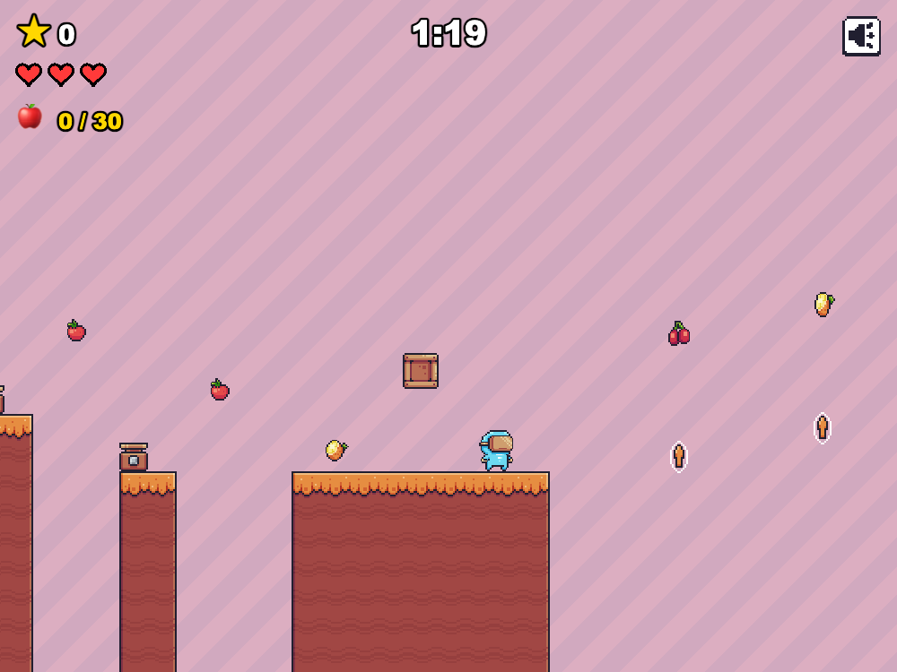

# Fruit Rush

Jeu de plateforme 2D en pixel-art. Choisissez votre héros, courez, sautez, ramassez un maximum de fruits
et atteignez la coupe avant la fin du chrono, à travers **5 niveaux** qui ont chacun leur forme et leur piège
phare : une plaine de piliers, une tour à gravir, des cavernes plongées dans le noir, une forteresse et un sprint au-dessus du vide.

Il se joue dans le navigateur, avec un classement en ligne partagé entre tous les joueurs.

<p align="center">
  
  
  
  
  
  
</p>

---

## Règles du jeu

### Le but
Atteignez la **coupe** au bout de chaque niveau. En chemin, ramassez les fruits et cassez les caisses pour
gagner des points. Finissez les 5 niveaux pour remporter la partie.

| Niveau | Parcours | Chrono |
|:-:|---|:-:|
| 1 | **Plaine verte** : la mise en jambes, de pilier en pilier, avec un trampoline, des pics, un feu et une plateforme fragile | 1:00 |
| 2 | **Pays de Bonbon** : une tour à gravir de bas en haut, de planche en planche, à coups de trampolines et de souffleurs | 1:15 |
| 3 | **Cavernes oubliées** : une descente dans le noir, où l'on ne voit qu'autour de soi ; puits, galeries basses, pointes au plafond, gouffres | 1:15 |
| 4 | **Forteresse maudite** : trois étages en zigzag, gardés par des Spike Heads, des scies et des rangées de feux | 1:30 |
| 5 | **Terres Brûlées** : un sprint d'îlot en îlot au-dessus du vide, avec des plateformes fragiles et des flèches qui relancent en l'air | 1:20 |

### Commandes
| Action | Touches (par défaut) |
|---|---|
| Aller à gauche | ← ou A |
| Aller à droite | → ou D |
| Sauter / double saut | Espace ou W |
| Pause et réglages | Échap |
| Couper le son | M |

On peut **sauter une deuxième fois en l'air** (double saut). Les touches se changent dans **Réglages**,
avec les volumes de la musique et des effets.

### Les héros
Quatre personnages au choix dans le menu : **Virtual Guy**, **Pink Man**, **Ninja Frog** et **Mask Dude**.
Le choix est purement esthétique : ils se jouent tous de la même façon.

### Les cœurs et le chrono
- Vous commencez avec **3 cœurs**.
- **Toucher un piège** fait perdre un cœur. Vous restez sur place et clignotez, invincible pendant 1,5 s.
- **Tomber dans un trou** fait perdre un cœur et vous ramène au dernier **checkpoint** touché (drapeau),
  ou au début du niveau.
- Chaque niveau a son **chrono** (de 1:00 à 1:30). Si le temps est écoulé, vous perdez un cœur et le niveau recommence.
- Plus de cœurs : **game over**.

### Les obstacles
| Obstacle | Effet |
|---|---|
| Pics | Au sol ou au plafond : font perdre un cœur |
| Feu | S'allume et s'éteint en rythme : dangereux seulement quand il brûle |
| Scie | Tourne et parcourt sa chaîne, à l'horizontale ou à la verticale : toujours dangereuse |
| Spike Head | Bloc à pointes qui s'abat quand vous passez dessous, puis remonte lentement |
| Plateforme fragile | Tremble quand on monte dessus, puis tombe : ne traînez pas |
| Trampoline | Vous propulse très haut et redonne le double saut |
| Souffleur | Son courant d'air vous soulève : laissez-vous porter, puis sautez de côté |
| Flèche | Bulle en l'air qui vous relance vers le haut et redonne le double saut |
| Checkpoint | Drapeau qui se lève à votre passage : c'est là que vous réapparaissez après une chute |
| Caisse | Se casse quand on la tape **par en dessous** |

### Les points
| Action | Points |
|---|---|
| Fruit ramassé | **+10** |
| Caisse cassée | **+50** |
| Temps restant à l'arrivée | **+1** par seconde |
| Cœur restant à la fin de la partie | **+200** par cœur |

Le score maximum possible est de **2 790 points**.

### Le classement
À la fin de la partie (victoire ou game over), si votre score entre dans le **top 15**, vous entrez votre
pseudo. Le classement est commun à tous les joueurs et visible depuis le menu (**Meilleurs scores**).

---

## Développement

Stack : JavaScript (ES modules) + Phaser 3 + Vite. Serveur : Express 5 + SQLite (better-sqlite3) pour le
classement en ligne.

### Lancer le projet
Prérequis : Node.js >= 18 (testé sur Node 20).

```bash
npm install
npm run dev      # jeu (Vite, http://localhost:3000) + API des scores (http://localhost:3001)
npm run build    # build statique du jeu dans dist/
npm start        # serveur de production : API + dist/ sur un seul port
```

En dev, Vite relaie `/api` vers le serveur des scores.

### API
- `GET  /api/scores`    → top 15
- `POST /api/run/start` → ouvre une partie, renvoie `{ runId }`
- `POST /api/scores`    → `{ runId, name, levels }` : le serveur recalcule lui-même le score

**Score calculé par le serveur** : le jeu n'envoie jamais de score. Il déclare ce qu'il a fait à chaque
niveau (fruits, caisses, temps, cœurs) ; le serveur vérifie ces chiffres contre les vrais maximums de
chaque niveau, l'ordre des niveaux et la durée de la partie, puis calcule le score. S'y ajoutent une
seule soumission par partie, une durée minimale par niveau et une limite de 20 requêtes / 10 min par IP.

### Déploiement
Un seul service Node sert le jeu et l'API. Le guide pas à pas pour un VPS (Node, systemd, Caddy, HTTPS,
nom de domaine) est dans [`docs/deploy-vps.md`](docs/deploy-vps.md).

La base des scores est dans `server/data/` (jamais versionnée).

### Structure
- `src/main.js`, `src/config.js` : démarrage de Phaser et constantes (vitesse, gravité, cœurs, chrono, bonus)
- `src/scenes/` : Menu, Game, GameOver, Victory, Settings, HighScores
- `src/levels/levels.js` : les 5 niveaux, dessinés en cartes ASCII (1 caractère = 1 tuile)
- `src/levels/parseLevel.js` : légende des cartes et lecture des niveaux (partagé avec le serveur)
- `scripts/check-levels.mjs` : `npm run check-levels` vérifie que chaque niveau est faisable (coupe,
  fruits, caisses et checkpoints atteignables) et donne le temps du chemin le plus rapide
- `src/entities/player/Player.js` : le héros (course, sauts, animations)
- `src/controls.js` : touches modifiables, sauvegardées dans le navigateur
- `src/audio/` : musique et bruitages (avec un synthé de secours si un son manque)
- `src/ui/` : boutons, titres, curseurs, saisie du pseudo, liste des scores
- `src/api/scores.js` : client de l'API
- `server/` : API Express + SQLite

Pour contribuer, `AGENT.md` détaille l'architecture, les conventions et les pièges connus du moteur.

## Crédits
- Graphismes : pack **Pixel Adventure 1** de [Pixel Frog](https://pixelfrog-assets.itch.io/pixel-adventure-1)
- Bruitages : packs [**Kenney**](https://kenney.nl) (CC0)
- Musique : **« 5 Chiptunes (Action) »** de Juhani Junkala, [OpenGameArt](https://opengameart.org/content/5-chiptunes-action) (CC0)

Le détail des sons est dans [`assets/audio/CREDITS.md`](assets/audio/CREDITS.md).
